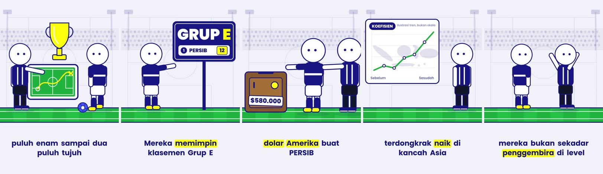

# Claude Code Skills for Video

[Claude Code](https://claude.com/claude-code) skills for making narrated vertical videos (YouTube Shorts, Instagram Reels, TikTok) with [HyperFrames](https://github.com/heygen-com/hyperframes): storyboard to video, narrated explainers, mirroring a reference video, and platform captions that read like a person wrote them.



## Skills

| Skill | Use when |
|---|---|
| [mirroring-reference-video](mirroring-reference-video/SKILL.md) | Someone shares a reference video, ad, Reel, Short or TikTok and wants their own video to follow its structure, pacing or visual style |
| [writing-platform-copy](writing-platform-copy/SKILL.md) | A finished video or post needs titles, captions, descriptions, tags or pinned comments for YouTube, TikTok, Instagram, Facebook, X, Threads or LinkedIn, in everyday language |
| [storyboard-to-video](storyboard-to-video/SKILL.md) | Someone gives a storyboard or scene-by-scene prompts plus a voice-over script and wants one narrated video drawn in code, with fact-checked claims |
| [drafting-threads-overview](drafting-threads-overview/SKILL.md) | A finished video or project should get a Threads thread that walks through how it was made, with posts that can be quoted later; Claude drafts and fills the composer, the author posts |
| [narrated-shorts](narrated-shorts/SKILL.md) | Making or revising a narrated vertical (9:16) Short, Reel or TikTok explainer in HyperFrames, or feedback on a render says a scene is dead, jumps at a cut or looks like AI slop |

## Install

Clone this repo, then link or copy a skill folder into your Claude Code skills directory:

```bash
git clone https://github.com/adimaulanat/claude-skills.git ~/claude-skills
ln -s ~/claude-skills/mirroring-reference-video ~/.claude/skills/mirroring-reference-video
ln -s ~/claude-skills/writing-platform-copy ~/.claude/skills/writing-platform-copy
ln -s ~/claude-skills/narrated-shorts ~/.claude/skills/narrated-shorts
ln -s ~/claude-skills/storyboard-to-video ~/.claude/skills/storyboard-to-video
ln -s ~/claude-skills/drafting-threads-overview ~/.claude/skills/drafting-threads-overview
```

Start a new Claude Code session; the skill then shows up in the skill list.

Works with: Claude Code, HyperFrames, ElevenLabs or any TTS, optional Brandfetch for brand palettes.

## How the skills work

Skills here are generic. They never assume your tools, look, language or format: each one reads your project's own instruction files first and asks you about anything those files do not answer. For `mirroring-reference-video`, a project can make this faster by documenting its design system, scaffold and render commands, voice tool, and where raw and private media go. For `narrated-shorts`, document your look and design system, voice tool, checkpoints and QA gates; the skill adds the beats table, transition, audio and feedback rules from the HyperFrames prompting docs. For `storyboard-to-video`, document your voice tool, fact-check sources and visual QA gate; it fills the gap between a storyboard and the beats table and defers the build to `narrated-shorts`. For `drafting-threads-overview`, document your Threads account and voice, disclosure rules and the style doc; it asks for the rest, then drafts and fills the composer without posting. For `writing-platform-copy`, document your language and voice, banned phrases, link and affiliate rules, and where the copy file lives.

## License

MIT, see [LICENSE](LICENSE).
